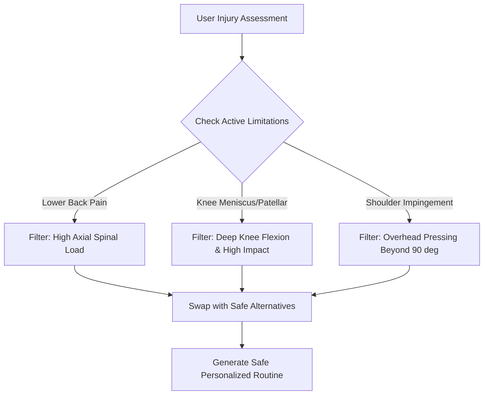

# PersonaFit - Personalized Fitness, Nutrition, and Injury Prevention Mobile System

> A capstone-oriented, deterministic rule-based Android mobile application with a PHP/Laravel & MySQL (XAMPP) backend for personalized workout routines, nutrition planning, and injury prevention.

---

## 1. Project Purpose

**PersonaFit** is a mobile health and fitness management system designed to solve the common pitfalls of generic workout apps: high dropout rates, unguided progression, and exercise-induced injuries. Most standard fitness applications offer "one-size-fits-all" routines that ignore individual biomechanical limitations, past injuries, and behavioral lifestyle patterns.

The system utilizes a **Deterministic Rule-Based Engine** (Expert System Decision Matrix) to evaluate a user's **Behavioral Fitness Persona** (schedule, environment, motivation type) alongside their **Physical Injury & Joint Limitations** (e.g., lower back pain, knee meniscus history, rotator cuff impingement). It calculates precise physiological targets (Mifflin-St Jeor TDEE, macronutrient splits) and prescribes customized, injury-safe workout routines with dynamic exercise substitutions.

The project is intentionally architected as a realistic, robust, and defensible academic capstone project combining native Android mobile development (`Kotlin` + `Jetpack Compose`) with a local/LAN-accessible backend (`PHP/Laravel` + `MySQL` on `XAMPP`).

### Primary Goals

- Eliminate one-size-fits-all workout injuries by automatically filtering contraindicated movements based on a user's joint and injury profile.
- Provide dynamic, safe exercise alternatives (e.g., swapping spinal-loading barbell squats with chest-supported leg presses for users with lumbar disc issues).
- Categorize users into evidence-based **Fitness Persona Archetypes** to determine realistic workout duration, split frequencies, and progression curves.
- Calculate exact energy expenditures and macronutrient splits using validated nutritional equations (Mifflin-St Jeor formula & Activity Multipliers).
- Leverage on-device hardware sensors (Android `SensorManager` Pedometer / Step Counter) for passive daily physical activity tracking.
- Provide a dedicated **Web Admin / CMS Portal** for fitness coaches/system administrators to manage the exercise library, contraindication tags, nutritional databases, and view aggregate user analytics.
- Ensure high usability, offline logging capability with local database caching, and responsive client-server synchronization over local LAN or standard networks.

### Key Constraints

| Constraint | Decision |
|---|---|
| Mobile Client Platform | Native Android (Min SDK 26 - Android 8.0+, Target SDK 34/35) |
| Mobile Framework | Kotlin with Jetpack Compose (Declarative UI & MVVM Architecture) |
| Backend & Server Runtime | PHP 8.2+ with Laravel 11 REST API hosted on XAMPP (Apache) for Dev; Cloud VPS/PaaS for Production |
| Database Engine | MySQL 8.0+ using InnoDB (foreign keys, transaction safety) |
| Network / Deployment | Local Development: Localhost (`10.0.2.2` / Local Wi-Fi IP); Live Demo: Ngrok Tunnel; Production: Cloud HTTPS API |
| AI / External Cloud Dependency | **Zero Black-box AI APIs**. 100% deterministic, rule-based expert logic and validated biomechanical formulas for transparent defense and grading |
| Development Tooling | Visual Studio Code (Backend & API testing) + Android Studio (Mobile UI, Emulator & Hardware debugging) |

---

## 2. Capstone Scope Strategy

To ensure a successful, on-time capstone completion and a convincing defense, features are organized into clear priority tiers.

### 2.1 Must Have - Core Capstone System (Baseline for Defense)

These features represent the mandatory working core required to pass the capstone evaluation:

1. **Authentication & Session Management**: Secure user registration, login, logout, and token-based authentication (Laravel Sanctum).
2. **Biometric & Persona Onboarding Questionnaire**: Collection of age, biological sex, height, weight, target goal, lifestyle habits, and persona classification.
3. **PAR-Q & Physical Limitation Screening**: Structured injury assessment capturing joint vulnerabilities (lower back, knees, shoulders, neck, wrists, ankles).
4. **Deterministic Prescription & Contraindication Engine**: Algorithmic exercise filtering that excludes contraindicated movements and provides biomechanically safe substitutions.
5. **Workout Routine Generation & Logging**: Display of daily routines, set/rep trackers, rest countdown timers, and workout completion logs.
6. **Nutrition & Hydration Targets**: Automatic Mifflin-St Jeor BMR/TDEE calculation, daily macro target breakdown (Protein, Carbs, Fats), and daily water intake logging.
7. **Native Step Counter (Pedometer)**: Passive step counting using Android hardware sensor (`Sensor.TYPE_STEP_COUNTER` / `TYPE_STEP_DETECTOR`).
8. **Progress Tracking & Analytics**: Interactive charts for weight progression, BMI history, workout consistency streaks, and total volume lifted.
9. **Web-Based Admin Portal**: Secure web dashboard to create/edit exercises, assign biomechanical injury tags, manage nutritional guides, and view user metrics.
10. **Offline Data Resilience**: Local caching via Android Room DB to allow workout and hydration logging when disconnected from the backend.

### 2.2 Should Have - Strong Supporting Features

These features add significant engineering depth and polish:

1. **Exercise Video/GIF Demonstrations**: Animated step-by-step form execution with highlighted "Common Mistakes / Injury Warnings".
2. **One-Tap Alternative Swap**: Ability for users to tap "Swap Exercise" during a live workout to pick from a list of filtered safe alternatives.
3. **Meal Diary**: Simple food logging module allowing users to track daily meals against their calculated macro targets.
4. **Workout Rest Timer with Audio Cues**: Built-in interval timer with beep notifications when rest periods conclude.
5. **PDF Workout & Progress Summary**: Exportable summary of user workout history and body metric changes.

### 2.3 Could Have - Polish and Enhancements

1. **Dark Mode / Dynamic Material You Theming**: Automatic color scheme switching according to system preferences.
2. **Push Notifications**: Local scheduled notifications reminding the user to hydrate, log meals, or start their scheduled workout.
3. **Personal Record (PR) Badges**: Gamified achievement badges for hitting consecutive workout streaks or weight milestones.

### 2.4 Future Enhancements (Documented for Panel Recommendations)

1. Wearable synchronization (Wear OS / Google Health Connect).
2. Computer-vision form correction using on-device ML Kit / Pose Detection.
3. Barcode scanning for instant grocery nutrition lookup.
4. Multi-trainer chat and direct video consultation booking.

---

## 3. Technology Stack

| Layer | Technology | Rationale |
|---|---|---|
| **Mobile Client (Android)** | **Kotlin 1.9+ & Jetpack Compose** | Modern Android industry standard; declarative UI replaces XML; reactive state management with StateFlow and ViewModel. |
| **Android Architecture** | **MVVM (Model-View-ViewModel) + Clean Architecture** | Decouples business logic from UI; highly testable and maintainable for capstone defense. |
| **Local Android Persistence** | **Room Database (SQLite) + Jetpack DataStore** | Provides robust offline caching for workout logs and encrypted storage for user auth tokens. |
| **Mobile Networking** | **Retrofit 2 + OkHttp 4 + Kotlinx Serialization** | Type-safe REST client for consuming Laravel backend endpoints with interceptors for auth tokens. |
| **Hardware Integration** | **Android SensorManager API** | Direct access to hardware step counter (`TYPE_STEP_COUNTER`) for low-power background activity tracking. |
| **Backend REST API** | **PHP 8.2+ with Laravel 11** | Clean MVC routing, built-in ORM (Eloquent), robust validation, and native token auth via Laravel Sanctum. |
| **Database** | **MySQL 8.0 (via XAMPP)** | Relational schema with foreign keys, indexing, and strict ACID transaction compliance. |
| **Admin Web Portal** | **Laravel Blade + Tailwind CSS / Bootstrap 5** | Integrated web portal bundled directly with the backend, eliminating multi-server deployment friction. |
| **API Testing Tool** | **Thunder Client (VS Code) / Postman** | Rapid endpoint verification and automated response schema validation. |
| **IDE / Workspaces** | **VS Code (Backend)** + **Android Studio Ladybug+ (Android)** | Optimized developer experience for both web API and native mobile compiling. |

---

## 4. System Architecture

### 4.1 Architecture Pattern

```text
+---------------------------------------------------------------+
|                      ANDROID MOBILE CLIENT                     |
|                                                               |
|  [Jetpack Compose UI Screens] <---> [ViewModels / StateFlow]  |
|                                            |                  |
|                                    [Repository Layer]         |
|                                     /              \          |
|                          [Room DB (Local)]   [Retrofit Client]|
+-------------------------------------------------------|-------+
                                                        | HTTP/JSON (LAN / Wi-Fi)
                                                        v
+---------------------------------------------------------------+
|                    LARAVEL 11 REST API (XAMPP)                |
|                                                               |
|   [Route Handler] --> [Sanctum Auth Middleware]               |
|                              |                                |
|                     [API Controllers]                         |
|                              |                                |
|             [Deterministic Rule & Prescription Engine]        |
|                              |                                |
|                     [Eloquent Models / ORM]                   |
+------------------------------|--------------------------------+
                               | SQL Queries (InnoDB)
                               v
+---------------------------------------------------------------+
|                    MYSQL DATABASE (XAMPP)                     |
|  - Users & Profiles       - Exercises & Contraindications     |
|  - Personas & Rules       - Workouts, Meals & Sensor Logs     |
+---------------------------------------------------------------+
                               ^
                               | Web Interface (HTTP)
+------------------------------|--------------------------------+
|             WEB ADMIN / TRAINER PORTAL (Blade / CSS)           |
+---------------------------------------------------------------+
```

### 4.2 Core Responsibilities

| Layer | Responsibility |
|---|---|
| **Mobile UI (Compose)** | Renders reactive screens (Onboarding, Workout Dashboard, Active Tracker, Nutrition Log, Analytics). |
| **Mobile ViewModel** | Manages UI state, coordinates coroutine dispatchers, and invokes repository actions. |
| **Mobile Repository** | Implements the single source of truth; fetches from network and updates local Room DB cache. |
| **Laravel API Router & Controllers** | Validates incoming payloads, manages user sessions, and returns structured JSON responses. |
| **Rule & Injury Engine** | Implements the contraindication matrix, calculates TDEE/macros, and selects matching workout splits. |
| **Database (MySQL)** | Stores relational tables, user history, exercise tags, audit trails, and lookup matrices. |
| **Admin Portal** | Allows administrators to create exercises, define injury exclusion rules, and monitor system metrics. |

---

## 5. Proposed Folder Structure

```text
persona-fit/
|-- persona-fit-backend/                    # Laravel 11 Backend & Admin Portal
|   |-- app/
|   |   |-- Http/
|   |   |   |-- Controllers/
|   |   |   |   |-- Api/
|   |   |   |   |   |-- AuthController.php
|   |   |   |   |   |-- AssessmentController.php
|   |   |   |   |   |-- WorkoutController.php
|   |   |   |   |   |-- NutritionController.php
|   |   |   |   |   |-- ActivityController.php
|   |   |   |   |   |-- ProgressController.php
|   |   |   |   |-- Admin/
|   |   |   |       |-- AdminDashboardController.php
|   |   |   |       |-- ExerciseManagementController.php
|   |   |   |       |-- InjuryRuleController.php
|   |   |   |-- Middleware/
|   |   |   |-- Requests/
|   |   |-- Models/
|   |   |   |-- User.php
|   |   |   |-- UserProfile.php
|   |   |   |-- FitnessPersona.php
|   |   |   |-- PhysicalLimitation.php
|   |   |   |-- Exercise.php
|   |   |   |-- ExerciseContraindication.php
|   |   |   |-- WorkoutPlan.php
|   |   |   |-- WorkoutLog.php
|   |   |   |-- MealLog.php
|   |   |   |-- StepLog.php
|   |   |-- Services/
|   |       |-- PersonaClassificationService.php
|   |       |-- InjuryPrescriptionEngine.php
|   |       |-- NutritionCalculatorService.php
|   |-- database/
|   |   |-- migrations/
|   |   |-- seeders/
|   |-- routes/
|   |   |-- api.php                         # Mobile App Endpoints
|   |   |-- web.php                         # Admin Portal Routes
|   |-- resources/
|   |   |-- views/admin/                    # Blade Templates for Admin Portal
|
|-- persona-fit-android/                    # Native Android Kotlin App
|   |-- app/
|   |   |-- src/main/
|   |       |-- java/com/personafit/app/
|   |       |   |-- data/
|   |       |   |   |-- local/              # Room DB, DAOs, Entities, DataStore
|   |       |   |   |-- remote/             # Retrofit ApiService, DTOs, Interceptors
|   |       |   |   |-- repository/         # Repository Implementations
|   |       |   |-- domain/
|   |       |   |   |-- model/              # Domain Data Models
|   |       |   |   |-- usecase/            # Business Use Cases
|   |       |   |-- presentation/
|   |       |   |   |-- auth/               # Login, Register Screens
|   |       |   |   |-- onboarding/         # Persona & Injury Assessment Wizard
|   |       |   |   |-- dashboard/          # Daily Overview & Metrics
|   |       |   |   |-- workout/            # Workout Plan, Active Tracker, Exercise Details
|   |       |   |   |-- nutrition/          # Macro Tracker, Meal & Water Logging
|   |       |   |   |-- steps/              # Pedometer & Sensor UI
|   |       |   |   |-- progress/           # Body Weight, BMI & Analytics Charts
|   |       |   |   |-- theme/              # Jetpack Compose Theme & Color Tokens
|   |       |   |-- sensor/                 # StepCounterManager & BroadcastReceivers
|   |       |   |-- di/                     # Dependency Injection Setup
|   |       |-- res/                        # Drawables, App Icons, Raw Assets
|   |-- build.gradle.kts
```

---

## 6. Core Modules & Deterministic Logic

### 6.1 Authentication & User Management
* **Registration & Login**: Secure email/password authentication using bcrypt hashing.
* **Token Authentication**: Laravel Sanctum generates bearer tokens stored securely in Android `EncryptedSharedPreferences` / `Jetpack DataStore`.
* **Role Separation**:
  * `app_user`: Android mobile clients.
  * `admin` / `coach`: Web portal administrators.

---

### 6.2 Biometrics & Fitness Persona Profiling Module

#### A. Mathematical Biometric Formulas
1. **Basal Metabolic Rate (BMR) - Mifflin-St Jeor Equation**:
   $$\text{BMR}_{\text{Men}} = (10 \times \text{weight in kg}) + (6.25 \times \text{height in cm}) - (5 \times \text{age in years}) + 5$$
   $$\text{BMR}_{\text{Women}} = (10 \times \text{weight in kg}) + (6.25 \times \text{height in cm}) - (5 \times \text{age in years}) - 161$$

2. **Total Daily Energy Expenditure (TDEE)**:
   $$\text{TDEE} = \text{BMR} \times \text{Activity Multiplier}$$
   * *Sedentary (Desk job)*: $1.2$
   * *Lightly Active (1-3 days/week)*: $1.375$
   * *Moderately Active (3-5 days/week)*: $1.55$
   * *Very Active (6-7 days/week)*: $1.725$

3. **Goal-Adjusted Caloric Target**:
   * *Fat Loss*: $\text{TDEE} - 500\text{ kcal}$
   * *Maintenance*: $\text{TDEE}$
   * *Muscle Gain*: $\text{TDEE} + 300\text{ kcal}$

4. **Macronutrient Split Matrix**:
   * *Protein*: $2.0\text{g per kg bodyweight}$ (4 kcal/g)
   * *Fat*: $25\%\text{ of total daily calories}$ (9 kcal/g)
   * *Carbohydrates*: Remaining calories divided by 4 kcal/g

#### B. Behavioral Persona Archetypes

| Persona Archetype | Key Characteristics | Prescribed Routine Strategy |
|---|---|---|
| **The Busy Professional** | Time-poor (<30 mins/day), high daily stress, sedentary work | 3-day full body split, High-Intensity/Low-Volume, supersets, focus on posture & mobility. |
| **The Gentle Starter** | Beginner, low confidence, easily overwhelmed | 3-day low-impact split, high repetition / bodyweight / machine exercises, progressive overload education. |
| **The Home Warrior** | Prefers exercising at home, limited dumbbell/resistance band equipment | Minimal-equipment calisthenics, resistance band routines, functional movement patterns. |
| **The Dedicated Athlete** | Experienced, 45-60+ mins available, access to commercial gym | 4-5 day Push/Pull/Legs or Upper/Lower split with progressive barbell and compound movements. |

---

### 6.3 Injury Screening & Biomechanical Contraindication Engine

The Injury Engine protects users by checking every candidate exercise against the user's logged joint limitations.



#### Deterministic Contraindication Rule Matrix

| Limitation / Injury Flag | Flagged Movement Patterns | Contraindicated Exercises (Excluded) | Safe Prescribed Substitutions |
|---|---|---|---|
| **Lower Back (Lumbar) Pain / Herniation** | Heavy axial loading, unsupported flexion | Barbell Back Squat, Conventional Deadlift, Bent-over Barbell Row | Leg Press, Supported Chest-Supported DB Row, Goblet Squat, Glute Bridges |
| **Knee Patellofemoral / Meniscus** | Deep acute knee shear, high impact jumping | Jump Squats, Deep Walking Lunges, Heavy Leg Extensions | Box Squats (parallel limit), Romanian Deadlifts (Hamstring-dominant), Static Wall Sits |
| **Shoulder Rotator Cuff / Impingement** | Extreme internal rotation, heavy overhead pressing | Barbell Overhead Press, Behind-the-neck Press, Upright Rows | Neutral-Grip Dumbbell Press, Incline DB Press, Cable Lateral Raises |
| **Wrist Tendinitis / Carpal Tunnel** | Extreme wrist extension under heavy load | Heavy Straight-Bar Bicep Curls, Barbell Bench Press | EZ-Bar Curls, Neutral-Grip Dumbbell Press, Push-up Handles |
| **Cervical / Neck Strain** | Cervical spine compression, heavy shrugging | Heavy Barbell Shrugs, Behind-neck Lat Pulldowns | Standard Lat Pulldowns to upper chest, Supported Face Pulls |

---

### 6.4 Workout Execution & Interactive Tracker
* **Routine Overview**: Shows today's target muscle groups, total estimated duration, and warmup requirements.
* **Interactive Set Logger**: Allows users to check off completed sets, log actual reps completed and weight (kg) lifted.
* **Smart Rest Timer**: Embedded countdown timer with pause/add 30s functions and acoustic finish notification.
* **Dynamic Swap Modal**: If a user experiences sudden discomfort during a workout, tapping *"Swap Exercise"* immediately queries the engine for safe biomechanical equivalents matching their equipment.

---

### 6.5 Nutrition & Hydration Management
* **Daily Macro Donut**: Real-time progress bar/ring tracking consumed vs target Calories, Protein, Carbohydrates, and Fats.
* **Meal Logger**: Fast entry for Breakfast, Lunch, Dinner, and Snacks.
* **Hydration Tracker**: One-tap quick-add buttons (+250ml, +500ml) with visual daily water bottle progress.

---

### 6.6 Native Android Activity & Sensor Integration
* **SensorManager Integration**: Uses native Android `Sensor.TYPE_STEP_COUNTER` to record passive step counts.
* **Offline Batching**: Steps are buffered in local Room DB and synced to the backend periodically to optimize mobile battery life.
* **Distance & Calorie Estimation**:
  $$\text{Distance (km)} = \text{Steps} \times (\text{Height (cm)} \times 0.415) / 100000$$
  $$\text{Calories Burned (kcal)} = \text{Steps} \times 0.04$$

---

### 6.7 Analytics & Progress Tracking
* **Interactive Charts**:
  * Body Weight Progression (Weekly/Monthly view).
  * Daily Step Consistency & Goal Target Completion.
  * Workout Completion Streaks & Weekly Adherence Rate.
* **BMI Metric**: Automatic categorization (Underweight, Normal, Overweight, Obese) based on height/weight updates.

---

### 6.8 Web Admin / Trainer Management Portal
* **Exercise Repository (CMS)**: Add/edit exercises with target muscle groups, difficulty level, equipment required, GIF/image URLs, and form instructions.
* **Contraindication Tag Manager**: Associate exercises with specific biomechanical risk tags (`lumbar_load`, `knee_shear`, `shoulder_impingement`).
* **User Analytics Directory**: View registered mobile users, adherence percentages, and system health status.

---

## 7. Database Design (MySQL 8.0)

### 7.1 Relational Schema Diagram (ERD Summary)

```text
 [users] 1 <---> 1 [user_profiles]
    |
    +---- 1 <---> N [user_limitations] >--- N <---> 1 [physical_limitations]
    |
    +---- 1 <---> N [workout_plans] 1 <---> N [workout_plan_exercises] >--- N <---> 1 [exercises]
    |                                                                                   |
    |                                              [exercise_contraindications] >-------+
    |
    +---- 1 <---> N [workout_logs] 1 <---> N [workout_log_items]
    |
    +---- 1 <---> N [meal_logs]
    |
    +---- 1 <---> N [water_logs]
    |
    +---- 1 <---> N [step_logs]
```

### 7.2 Core Table Definitions

#### `users`
| Column | Type | Constraints | Description |
|---|---|---|---|
| `id` | BIGINT UNSIGNED | PK, Auto Increment | Primary key |
| `name` | VARCHAR(100) | NOT NULL | User full name |
| `email` | VARCHAR(150) | UNIQUE, NOT NULL | Login email address |
| `password` | VARCHAR(255) | NOT NULL | Bcrypt hashed password |
| `role` | ENUM('app_user', 'admin') | DEFAULT 'app_user' | Access control level |
| `created_at` / `updated_at` | TIMESTAMP | NULL | Timestamps |

#### `user_profiles`
| Column | Type | Constraints | Description |
|---|---|---|---|
| `id` | BIGINT UNSIGNED | PK, Auto Increment | Primary key |
| `user_id` | BIGINT UNSIGNED | FK -> users(id), CASCADE | Linked user |
| `gender` | ENUM('male', 'female') | NOT NULL | Biological sex for BMR |
| `age` | INT | NOT NULL | Age in years |
| `height_cm` | DECIMAL(5,2) | NOT NULL | Height in centimeters |
| `weight_kg` | DECIMAL(5,2) | NOT NULL | Current weight in kilograms |
| `target_weight_kg` | DECIMAL(5,2) | NULL | Desired target weight |
| `activity_level` | ENUM('sedentary', 'light', 'moderate', 'very_active') | NOT NULL | Activity factor |
| `fitness_goal` | ENUM('fat_loss', 'maintenance', 'muscle_gain') | NOT NULL | Primary objective |
| `persona_archetype`| ENUM('busy_pro', 'gentle_starter', 'home_warrior', 'athlete') | NOT NULL | Calculated persona |
| `daily_calories` | INT | NOT NULL | Calculated daily calorie target |
| `protein_grams` | INT | NOT NULL | Daily protein target |
| `carbs_grams` | INT | NOT NULL | Daily carbohydrate target |
| `fat_grams` | INT | NOT NULL | Daily fat target |
| `water_ml_target` | INT | DEFAULT 2500 | Daily hydration target |

#### `physical_limitations` (Lookup Table)
| Column | Type | Constraints | Description |
|---|---|---|---|
| `id` | BIGINT UNSIGNED | PK, Auto Increment | Primary key |
| `code` | VARCHAR(50) | UNIQUE, NOT NULL | E.g., `LOWER_BACK_PAIN`, `KNEE_PAIN`, `SHOULDER_IMPINGEMENT` |
| `name` | VARCHAR(100) | NOT NULL | Human-readable title |
| `description` | TEXT | NULL | Clinical/Biomechanic explanation |

#### `user_limitations` (Pivot Table)
| Column | Type | Constraints | Description |
|---|---|---|---|
| `user_id` | BIGINT UNSIGNED | FK -> users(id), CASCADE | User reference |
| `limitation_id` | BIGINT UNSIGNED | FK -> physical_limitations(id) | Limitation reference |
| `severity` | ENUM('mild', 'moderate', 'severe') | DEFAULT 'moderate' | Severity level |

#### `exercises`
| Column | Type | Constraints | Description |
|---|---|---|---|
| `id` | BIGINT UNSIGNED | PK, Auto Increment | Primary key |
| `name` | VARCHAR(150) | NOT NULL | E.g., "Chest Supported DB Row" |
| `target_muscle` | VARCHAR(50) | NOT NULL | E.g., "Back", "Chest", "Quads" |
| `equipment_type` | ENUM('bodyweight', 'dumbbell', 'barbell', 'machine', 'bands') | NOT NULL | Required gear |
| `difficulty` | ENUM('beginner', 'intermediate', 'advanced') | NOT NULL | Experience level |
| `instructions` | TEXT | NOT NULL | Step-by-step guidance |
| `common_mistakes` | TEXT | NULL | Injury prevention warnings |
| `image_url` | VARCHAR(255) | NULL | Demonstration asset path |

#### `exercise_contraindications` (Rule Mapping Table)
| Column | Type | Constraints | Description |
|---|---|---|---|
| `id` | BIGINT UNSIGNED | PK, Auto Increment | Primary key |
| `exercise_id` | BIGINT UNSIGNED | FK -> exercises(id), CASCADE | The excluded exercise |
| `limitation_id` | BIGINT UNSIGNED | FK -> physical_limitations(id) | The triggering limitation |
| `alternative_exercise_id` | BIGINT UNSIGNED | FK -> exercises(id) | The recommended replacement |

#### `workout_logs` & `workout_log_items`
| Table | Key Columns | Description |
|---|---|---|
| `workout_logs` | `id`, `user_id`, `started_at`, `completed_at`, `total_duration_seconds`, `status` | High-level workout session record |
| `workout_log_items` | `id`, `workout_log_id`, `exercise_id`, `set_number`, `reps_completed`, `weight_kg`, `is_completed` | Granular per-set logging |

#### `step_logs`
| Column | Type | Constraints | Description |
|---|---|---|---|
| `id` | BIGINT UNSIGNED | PK, Auto Increment | Primary key |
| `user_id` | BIGINT UNSIGNED | FK -> users(id), CASCADE | User reference |
| `log_date` | DATE | NOT NULL | Date of recorded steps |
| `step_count` | INT | NOT NULL | Total steps for the day |
| `distance_km` | DECIMAL(5,2) | NOT NULL | Calculated distance |
| `calories_burned` | DECIMAL(6,2) | NOT NULL | Estimated energy expenditure |

---

## 8. Security & Data Integrity Design

1. **Token Protection (Sanctum)**: REST endpoints require `Authorization: Bearer <token>`. Tokens expire after 30 days and are revocable upon logout.
2. **Password Encryption**: All passwords stored using standard `bcrypt` hashing with salt rounds $\ge 10$.
3. **Prepared Statements**: All database operations managed through Laravel Eloquent / PDO prepared statements, fully eliminating SQL Injection vulnerabilities.
4. **Input Validation**: Strict request validation on all API endpoints (e.g., bounds checking on height: $100 \le \text{height} \le 250\text{ cm}$; weight: $30 \le \text{weight} \le 300\text{ kg}$).
5. **Mobile Local Security**: Tokens and sensitive biometric caches stored via Android Jetpack `EncryptedSharedPreferences` / Proto DataStore.

---

## 9. RESTful API Endpoint Design

All endpoints are prefixed with `/api`.

### 9.1 Authentication Endpoints
```text
POST /api/auth/register          # Register new user
POST /api/auth/login             # Authenticate & return Sanctum Token
POST /api/auth/logout            # Invalidate current token
GET  /api/auth/me                # Get authenticated user profile & permissions
```

### 9.2 Onboarding & Assessment Endpoints
```text
GET  /api/assessment/limitations # Fetch master list of physical limitations/injuries
POST /api/assessment/submit      # Submit biometrics, persona quiz, and injury flags
GET  /api/assessment/summary     # Get calculated TDEE, macros, and assigned persona
```

### 9.3 Workout Management Endpoints
```text
GET  /api/workouts/today         # Get today's tailored, injury-filtered workout routine
GET  /api/workouts/alternatives/{exercise_id} # Get safe alternative exercises for swap
POST /api/workouts/start         # Initialize a new active workout session
POST /api/workouts/log-set       # Log set reps, weight, and completion state
POST /api/workouts/complete      # Finalize workout session and save summary
GET  /api/workouts/history       # Retrieve paginated past workout logs
```

### 9.4 Nutrition & Activity Endpoints
```text
GET  /api/nutrition/today        # Get today's target vs logged calories & macros
POST /api/nutrition/log-meal     # Record a meal entry (name, calories, protein, carbs, fat)
POST /api/nutrition/log-water    # Add water intake (+250ml, +500ml)
POST /api/activity/sync-steps    # Sync daily step count from Android sensor
GET  /api/progress/dashboard     # Retrieve 30-day analytics (weight, steps, adherence)
```

---

## 10. UI/UX Design System & Screen Flow

### 10.1 Mobile Screen Navigation Flow

```text
[Splash Screen]
       |
       v
[Login / Register]
       |
       v (First Time Login)
[Onboarding Wizard: 1. Biometrics -> 2. Persona Quiz -> 3. Injury Screening]
       |
       +----------------------------+
       |                            |
       v                            v
[Main App Bottom Navigation]   [Assessment Summary]
   |-- 1. [Dashboard Screen] (Today's Plan, Calories Donut, Step Counter, Streak)
   |-- 2. [Workout Screen]   (Daily Exercise Routine, Exercise Guide, Start Session)
   |-- 3. [Active Workout]   (Live Sets/Reps, Rest Timer, "Swap Exercise" Modal)
   |-- 4. [Nutrition Screen] (Meal Logger, Water Tracker, Macro Breakdown)
   |-- 5. [Progress Screen]  (Weight Graph, Step Charts, Workout History)
   |-- 6. [Profile & Injury] (Update Biometrics, Re-take Injury Assessment)
```

### 10.2 Color Palette (Obsidian & Electric Mint - Modern Athletic Performance)

Designed for ultra-high contrast ($\ge 7:1$ WCAG AAA), 3ft-glanceability during workouts, and eliminating unreadable white-on-white text collisions:

| Token | Hex Value | Semantic Usage & Contrast Role |
|---|---|---|
| **Background (Obsidian)** | `#0B0F12` | Deep slate-black canvas; prevents screen washout and saves OLED battery |
| **Surface Card (Night Charcoal)** | `#151C22` | Elevated surface for all cards, list tiles, and bottom sheets |
| **Surface Elevated** | `#1E2730` | Active input fields, button containers, pill badges |
| **Border Dark** | `#263540` | Crisp 1dp card borders for clear visual separation |
| **Primary Accent (Electric Mint)** | `#00E599` | Primary CTA buttons, active tab indicators, progress ring fills |
| **Secondary Accent (Solar Flame)** | `#FF6B4A` | Calorie energy meters, streak flame icons (🔥), volume metrics |
| **Joint Safety (Clinical Emerald)**| `#10B981` | Active injury safeguards, contraindication substitution tags |
| **Text Primary (High Contrast)** | `#FFFFFF` | 100% pure crisp white for all titles, headlines, and primary values |
| **Text Secondary (Cool Silver)** | `#94A3B8` | Soft light silver for subtitles, units (kg, reps, kcal), timestamps |
| **Text Muted** | `#64748B` | Inactive icons, subtle captions |
| **Error / Alert** | `#EF4444` | Form validation errors, contraindicated movement warnings |

---

## 11. Implementation Roadmap

### Phase 1 - Foundation & Backend Setup (Week 1)
1. Initialize Laravel 11 project in `xampp/htdocs/persona-fit/persona-fit-backend`.
2. Configure `.env` database connection to MySQL (`persona_fit_db`).
3. Build database migrations (users, profiles, limitations, exercises, contraindications).
4. Seed master exercise database with $\ge 40$ structured exercises and contraindication tags.
5. Set up Laravel Sanctum for API token issuance and user registration/login controllers.

### Phase 2 - Deterministic Engine & Admin Portal (Week 2)
1. Implement `InjuryPrescriptionEngine` service with contraindication exclusion and swap logic.
2. Implement `PersonaClassificationService` and `NutritionCalculatorService` (Mifflin-St Jeor).
3. Build the Web Admin Portal (Blade views) for managing exercises and viewing injury rules.
4. Test all REST endpoints thoroughly using Thunder Client / Postman.

### Phase 3 - Android Project Setup & Architecture (Week 3)
1. Initialize Android project (`persona-fit-android`) in Android Studio with Jetpack Compose.
2. Setup Hilt (or Koin) for Dependency Injection, Retrofit client with Auth Interceptors, and Room DB.
3. Build the Material 3 Theme (Colors, Typography, Shapes).
4. Implement Splash, Login, and Registration screens with validation.

### Phase 4 - Onboarding Wizard & Persona Assessment (Week 4)
1. Build multi-step Onboarding Wizard (Biometrics $\rightarrow$ Lifestyle/Persona Quiz $\rightarrow$ Injury Checklist).
2. Connect wizard submission to `POST /api/assessment/submit`.
3. Display personalized assessment summary screen (TDEE, Macros, Persona, Injury Flags).

### Phase 5 - Workout Routine & Active Tracker (Week 5)
1. Build Daily Workout Screen showing prescribed injury-safe exercises.
2. Implement the **Active Workout Session** screen:
   * Interactive checkbox set logging.
   * Built-in countdown rest timer with audio alert.
   * One-tap *"Swap Exercise"* modal querying alternative safe movements.
3. Save completed workouts to backend and cache in local Room DB for offline viewing.

### Phase 6 - Nutrition, Sensor Integration & Analytics (Week 6)
1. Build Nutrition screen with real-time calorie/macro rings and meal logging dialog.
2. Build one-tap Hydration logger (+250ml / +500ml).
3. Implement native Android `SensorManager` Pedometer step counting service.
4. Build Progress Analytics screen with dynamic weight and step history charts.

### Phase 7 - Testing, Polish & Defense Preparation (Week 7)
1. Perform end-to-end integration testing between Android Emulator / Physical phone and XAMPP backend.
2. Test offline resilience (logging workouts while in Airplane Mode and syncing on reconnect).
3. Prepare capstone demonstration script, test case validation logs, and defense presentation deck.

---

## 12. Verification & Testing Plan

### 12.1 Functional Test Matrix

| Test ID | Module / Feature | Input Condition | Expected System Output |
|---|---|---|---|
| **TC-01** | User Auth | Valid registration credentials | User created in MySQL, Sanctum token returned, stored in DataStore. |
| **TC-02** | BMR/TDEE Engine | Male, 25 yrs, 75kg, 180cm, Moderately Active, Fat Loss | $\text{BMR} = 1755\text{ kcal}$, $\text{TDEE} \approx 2720\text{ kcal}$, Target $\approx 2220\text{ kcal}$, High protein split. |
| **TC-03** | Injury Engine (Back) | Limitation: `LOWER_BACK_PAIN` | Routine automatically excludes Barbell Squat/Deadlift; substitutes Leg Press & Supported Rows. |
| **TC-04** | Injury Engine (Knee) | Limitation: `KNEE_PAIN` | Routine excludes jumping squats & lunges; prescribes box squats and hamstring-focused movements. |
| **TC-05** | Live Swap Feature | Tap "Swap" on Dumbbell Shoulder Press with `SHOULDER_IMPINGEMENT` active | Returns safe alternatives (e.g., Incline Neutral DB Press or Cable Lateral Raises). |
| **TC-06** | Hardware Pedometer | Walk 100 steps with physical Android device | Android `Sensor.TYPE_STEP_COUNTER` increments step count by 100; updates dashboard UI. |
| **TC-07** | Offline Resilience | Disconnect Wi-Fi, log completed workout | Session stored in local Room DB; syncs to MySQL immediately upon network reconnection. |

### 12.2 Security & Integrity Testing
* **SQL Injection Test**: Inject SQL strings (`' OR '1'='1`) in search and auth inputs $\rightarrow$ Blocked by Eloquent PDO binding.
* **Unauthorized API Access**: Request `/api/workouts/today` without token $\rightarrow$ HTTP 401 Unauthorized returned.
* **Token Invalidation**: Call `/api/auth/logout` $\rightarrow$ Subsequent requests using old token are rejected.

---

## 13. Capstone Defense Rationale

### Why PersonaFit is an Exemplary Capstone Project

1. **High Practical & Social Value**: Directly tackles user injury risks and workout dropout rates, delivering a health solution backed by real biomechanical principles.
2. **Transparent, Deterministic Logic**: Unlike unpredictable black-box AI models, PersonaFit relies on **verifiable expert decision trees** and **peer-reviewed physiological formulas** (Mifflin-St Jeor), making it easy to validate and explain during academic defense.
3. **Comprehensive Full-Stack Engineering**:
   * **Mobile Engineering**: Native Kotlin, Jetpack Compose, StateFlow, Coroutines, Room DB, Hardware Sensor APIs.
   * **Backend Engineering**: RESTful API design, Laravel Sanctum token security, Eloquent ORM, automated service layers.
   * **Database Engineering**: Normalized MySQL relational schema with foreign key constraints, pivot tables, and indexes.
4. **Hardware Integration**: Real-world application of native mobile hardware sensors (`SensorManager` Pedometer).
5. **Clear Separation of Concerns**: Clean Architecture and MVVM patterns separate UI, domain logic, and data layers.

---

## 14. Open Decisions

Before writing source code, confirm the following project choices:
1. **Physical Testing Device**: Will you primarily test the Android app on an **Android Studio Emulator** (using `10.0.2.2:8000`) or a **Physical Android Phone** connected over local Wi-Fi?
2. **Exercise Asset Hosting**: Should exercise GIF/image demonstration files be stored locally in Laravel's `public/uploads/exercises/` directory or referenced via reliable public web URLs?
3. **Food Library Depth**: Will the meal logging module use a simple quick-calorie/macro input form, or a pre-seeded lookup table of common food items? *(Recommended for Capstone: Pre-seeded lookup table with manual custom entry option).*

---

## 15. Assumptions and Limitations

- The backend runs on a local machine using XAMPP (Apache and MySQL) accessible over LAN.
- The mobile application requires an Android device running Android 8.0 (API level 26) or higher.
- The step counter sensor accuracy depends on the physical device's onboard hardware pedometer sensor.
- The application provides fitness and nutritional guidance based on standard formulas, but does not substitute for certified clinical orthopedic diagnoses.

---

## 16. Health, Safety & Ethical Considerations

- **PAR-Q Disclaimer**: Users must acknowledge a physical activity readiness disclaimer during onboarding.
- **Safety First Metric**: High-risk exercises are conservatively excluded whenever any doubt exists regarding joint pain.
- **Data Privacy**: Biometric records and injury histories are tied strictly to the authenticated user ID and never exposed publicly.

---

## 17. Success Criteria

The project is considered completely successful and defense-ready when:
- [x] User can register, log in, and complete the biometric & injury assessment wizard.
- [x] Backend calculates accurate BMR, TDEE, macros, and assigns an appropriate fitness persona.
- [x] Workout routines dynamically exclude exercises matching the user's active injury limitations.
- [x] User can execute a workout session, log reps/weights, use the rest timer, and swap exercises safely.
- [x] Hardware pedometer sensor accurately increments daily step counts.
- [x] Admin can add/edit exercises and configure contraindication tags in the Web Portal.
- [x] All data correctly synchronizes with the MySQL database on XAMPP.

---

## 18. Non-Functional Requirements

| Metric | Requirement |
|---|---|
| **Response Time** | API responses delivered within $<200\text{ms}$ over local network. |
| **Mobile UI Performance** | Smooth 60 FPS scrolling in Jetpack Compose lists with zero UI thread freezing. |
| **Battery Efficiency** | Step counter operates passively via system batching to prevent background battery drain. |
| **Offline Tolerance** | Core workout and hydration logging functions without an active internet connection. |
| **Maintainability** | Clean codebase adhering to PSR-12 for PHP/Laravel and Kotlin Official Coding Conventions. |

---

## 19. Out of Scope

The following items are intentionally excluded from the initial capstone version to maintain focus:
- Real-time computer vision camera rep counting / pose estimation.
- Cloud payment gateways (Stripe/PayPal) or premium subscription billing.
- Wearable smart watch pairing (Apple Watch / Galaxy Watch).
- Real-time multiplayer fitness competitions.

---

## 20. Recommended Final Scope for Defense

For the final capstone presentation, the demonstrated working system will feature:
1. **User Authentication & Secure Token Storage**.
2. **Interactive Biometric, Persona & Joint Limitation Assessment**.
3. **Deterministic Injury Prevention & Routine Generation Engine**.
4. **Active Workout Session Mode (Live set logging, rest timer, safe exercise swapping)**.
5. **Nutrition Target Calculation & Daily Meal/Hydration Logging**.
6. **Native Android Pedometer Sensor Step Tracking**.
7. **Progress Charts (Weight, BMI, Consistency Streaks)**.
8. **Web Admin / CMS Portal for Exercise & Contraindication Rule Management**.

---

## 21. Future Cloud Deployment & Public Release Strategy

Once local testing and the initial capstone defense are complete, the system is designed to transition seamlessly from local XAMPP to a full public cloud release without refactoring application logic.

### 21.1 Staged Rollout Lifecycle

```text
+-------------------------------------------------------------------------------+
| STAGE 1: LOCAL DEVELOPMENT & UNIT TESTING (Current)                           |
| - Backend: PHP 8.2+ / Laravel 11 on XAMPP (Apache & MySQL)                    |
| - Mobile: Android Studio Emulator (10.0.2.2:8000) & Local Wi-Fi Device        |
| - Cost: $0                                                                    |
+-------------------------------------------------------------------------------+
                                      |
                                      v
+-------------------------------------------------------------------------------+
| STAGE 2: LIVE CAPSTONE DEFENSE & DEMO (Ngrok / Cloudflare Tunnel)             |
| - Expose local XAMPP backend via `ngrok http 8000` -> Public HTTPS URL        |
| - Panelists and evaluator phones connect anywhere via Mobile 4G/5G data       |
| - Cost: $0 (Free Tier)                                                        |
+-------------------------------------------------------------------------------+
                                      |
                                      v
+-------------------------------------------------------------------------------+
| STAGE 3: PUBLIC CLOUD PRODUCTION RELEASE                                      |
| - Backend: Linux VPS (DigitalOcean / Hetzner / Hostinger) or PaaS (Railway)   |
| - Database: Managed MySQL 8.0 with automated nightly backups                  |
| - Domain & Security: Custom domain (api.personafit.app) + Free Let's Encrypt  |
| - Android App: Signed APK distribution or Google Play Store Release           |
| - Cost: ~$3.50 to $5.00 / month                                               |
+-------------------------------------------------------------------------------+
```

### 21.2 Backend Cloud Hosting Options & Recommendations

| Strategy | Recommended Provider | Monthly Cost | Deployment Workflow |
|---|---|---|---|
| **Free PaaS (Zero Cost)** | **Railway.app / Render.com** | $0 (Free Tier) | Connects directly to GitHub; automatically builds Laravel Docker container and spins up managed MySQL. |
| **Linux VPS (Production-Grade)** | **DigitalOcean / Hostinger VPS / Hetzner** | ~$3.50 - $5.00 / mo | Full root access on Ubuntu Linux, Nginx reverse proxy, PHP-FPM 8.2, MySQL 8.0, and certbot SSL. |
| **Traditional cPanel** | **Hostinger / Namecheap Shared** | ~$2.00 / mo | Direct file upload to `public_html`, database imported via web phpMyAdmin. |

### 21.3 Android App Public Distribution Pipeline

1. **Environment Configuration (`build.gradle.kts`)**:
   ```kotlin
   buildTypes {
       debug {
           buildConfigField("String", "BASE_URL", "\"http://10.0.2.2:8000/api/\"")
       }
       release {
           isMinifyEnabled = true
           proguardFiles(getDefaultProguardFile("proguard-android-optimize.txt"), "proguard-rules.pro")
           buildConfigField("String", "BASE_URL", "\"https://api.personafit.app/api/\"")
       }
   }
   ```
2. **Direct APK Release (Free & Immediate)**:
   * Generate a signed release APK in Android Studio: `Build -> Generate Signed Bundle / APK -> APK`.
   * Distribute the APK via GitHub Releases, Google Drive, or personal portfolio website for immediate public installation.
3. **Google Play Store Publishing (Official App Store)**:
   * Register a Google Play Developer Account ($25 one-time fee).
   * Generate an Android App Bundle (`.aab`).
   * Complete standard store listing (Screenshots, Privacy Policy link, Content Rating Questionnaire).

---
*End of PersonaFit Capstone Architecture & Planning Specification.*
